<div align="center">

  <!-- Header Banner / Animated Cyber-Cloud Wave -->
  <a href="https://github.com/aishwaryabelekar-devops">
    
  </a>

  <!-- Unique Animated Typing Headline -->
  <a href="https://github.com/aishwaryabelekar-devops">
    
  </a>

  <!-- Cyber Badge Deck -->
  <p align="center">
    
    
    
    
  </p>

  <h3>Junior DevOps Engineer · Azure Cloud · Terraform · Azure DevOps CI/CD</h3>
  <p><b>Deterministic infrastructure. Reusable Terraform modules. Repeatable Azure DevOps automation.</b></p>

  <p align="center">
    <a href="https://www.linkedin.com/"></a>
    <a href="https://github.com/aishwaryabelekar-devops?tab=repositories"></a>
    <a href="mailto:aishwarya.belekar.work@gmail.com"></a>
    <a href="#-hands-on-infrastructure-projects"></a>
  </p>

</div>

---

## 👋 About Me

Hi, I'm **Aishwarya**! I am a **Junior DevOps Engineer** (and aspiring Azure DevOps Consultant) specializing in **Microsoft Azure, Terraform (Infrastructure as Code), Git, and Azure DevOps CI/CD automation**. With approximately two years of hands-on practical focus, I build, structure, and automate cloud environments with an emphasis on reusability, security fundamentals, and repeatability.

My day-to-day engineering revolves around writing clean, parameterized **Terraform modules**, configuring remote backend state storage with blob locking in Azure Storage Accounts, and orchestrating multi-stage **Azure DevOps YAML pipelines** using reusable templates for `init`, `validate`, `plan`, and gated `apply` workflows. I also focus on foundational cloud architecture—implementing **Azure Landing Zone fundamentals**, resource hierarchies, **Hub-and-Spoke networking**, Network Security Groups (NSGs), and Role-Based Access Control (RBAC).

- 📍 **Core Focus:** Microsoft Azure, Terraform (IaC), Azure DevOps YAML Pipelines, Git & GitHub Workflows
- 🧱 **Infrastructure Patterns:** Modular Terraform design, environment separation (`.tfvars`), Hub-and-Spoke networking, and Azure Landing Zone principles
- 🔄 **Automation Standard:** Reusable pipeline templates, ARM service connections, automated plan generation, and safe change validation
- 💡 **Engineering Creed:** *Code every piece of infrastructure, review execution plans before applying, isolate environments with least privilege, and automate delivery with clean CI/CD.*
- 🤝 [Connect on LinkedIn](https://www.linkedin.com/) · 📧 [aishwarya.belekar.work@gmail.com](mailto:aishwarya.belekar.work@gmail.com)

---

## 🧭 Infrastructure & Automation Architecture

The diagram below outlines the core technical workflow and infrastructure lifecycle I practice across Azure, Terraform, and Azure DevOps:

```mermaid
flowchart TB
    A[DevOps & Cloud Automation Workflow] --> B[Azure Cloud Foundations]
    A --> C[Infrastructure as Code]
    A --> D[CI/CD & Pipelines]
    A --> E[Version Control & Collaboration]

    B --> B1[Resource Groups & Subscriptions]
    B --> B2[VNets, Subnets & NSG Rules]
    B --> B3[Hub-and-Spoke Networking]
    B --> B4[Azure Policy & RBAC Access]

    C --> C1[Terraform Providers & Syntax]
    C --> C2[Variables, Outputs & tfvars]
    C --> C3[Reusable Child Modules]
    C --> C4[Remote State with Lease Locking]

    D --> D1[Azure DevOps YAML Pipelines]
    D --> D2[Stages, Jobs & Steps Structure]
    D --> D3[ARM Service Connections]
    D --> D4[Reusable Plan & Apply Templates]

    E --> E1[Git Branching & Pull Requests]
    E --> E2[GitHub Repositories & Reviews]
    E --> E3[Learning GitHub Actions Workflows]
```



---

## 🧰 Technology Stack & Technical Focus

<div align="center">

[](https://skillicons.dev)

</div>

<br/>

| Domain | Tools & Hands-on Production Focus |
|:---|:---|
| ☁️ **Microsoft Azure** | Azure Virtual Networks (VNets), Subnets, Resource Groups, Network Security Groups (NSGs), Azure RBAC, Azure Key Vault fundamentals, Hub-and-Spoke networking concepts, Management Groups, and Azure Policy fundamentals |
| 🏗️ **Terraform (IaC)** | Terraform configuration, `azurerm` provider, input variables, outputs, `terraform.tfvars`, reusable child modules, CLI workflows (`init`, `fmt`, `validate`, `plan`, `apply`), and remote state in Azure Blob Storage with lease locking |
| 🔄 **Azure DevOps & CI/CD** | Azure DevOps YAML pipelines, multi-stage pipelines (stages, jobs, steps), Azure Repos, reusable YAML templates for Terraform workflows, Azure Resource Manager (ARM) service connections, pipeline variables, and basic CI/CD troubleshooting |
| 🐙 **Git & Version Control** | Git fundamentals (branching, commits, merging, pull requests, code reviews), GitHub repository management, and actively exploring GitHub Actions workflows |
| 💻 **Scripting & Systems** | Bash shell scripting, PowerShell cmdlets for Azure resource management, Linux fundamentals (Ubuntu/Debian environment, filesystem permissions, SSH), and foundational Python scripting |

---

## 🚀 Hands-on Infrastructure Projects

Here are the key practical projects and lab architectures I develop to deliver reliable Azure infrastructure and CI/CD automation:

### 1. 🏗️ [Modular Azure Infrastructure with Terraform](https://github.com/aishwaryabelekar-devops)
A hands-on Infrastructure as Code project demonstrating how to break down Azure resources into clean, reusable Terraform child modules.
- Provisions Azure Resource Groups, Virtual Networks (VNets), segmented subnets, and Network Security Groups (NSGs) using parameterized child modules.
- Implements `variables.tf`, `outputs.tf`, and environment-specific `.tfvars` files to support multiple environments (dev and test).
- Configures remote backend state storage in an Azure Storage Account container with blob lease locking to prevent state corruption during concurrent runs.
- *Technologies:* Terraform, `azurerm` provider, Azure Storage, HCL

---

### 2. 🔄 [Azure DevOps Multi-Stage Terraform Pipeline](https://github.com/aishwaryabelekar-devops)
A modular CI/CD pipeline built with Azure DevOps YAML to automate Terraform validation, planning, and deployment.
- Organizes the pipeline into distinct stages: **Validate** (`terraform fmt` & `terraform validate`), **Plan** (`terraform plan`), and **Apply** (`terraform apply`).
- Uses reusable YAML step templates to keep pipeline definitions DRY (Don't Repeat Yourself) and easy to maintain across repositories.
- Integrates with an Azure Resource Manager (ARM) Service Connection to authenticate securely without hardcoded credentials.
- Includes manual approval gates on the Apply stage to ensure infrastructure changes are reviewed before execution.
- *Technologies:* Azure DevOps, YAML Pipelines, Azure Repos, ARM Service Connections, Terraform

---

### 3. 🌐 [Azure Hub-and-Spoke Networking Lab](https://github.com/aishwaryabelekar-devops)
A practical architecture project designed to implement enterprise network topology and traffic isolation concepts in Microsoft Azure.
- Deploys a central Hub Virtual Network with dedicated subnets for Gateway and Shared Services.
- Configures Spoke Virtual Networks connected to the Hub via VNet Peering to practice network segmentation and workload isolation.
- Implements custom Network Security Group (NSG) security rules and User Defined Routes (UDRs) to understand traffic routing and subnet isolation.
- *Technologies:* Azure Networking, VNets, Subnets, VNet Peering, NSGs, UDRs

---

### 4. 📐 [Azure Landing Zone & Resource Hierarchy Lab](https://github.com/aishwaryabelekar-devops)
A foundational cloud governance project exploring how resources and policies are structured in the Microsoft Cloud Adoption Framework (CAF).
- Practices organizing Azure resources using Management Groups, Subscriptions, and Resource Groups.
- Tests foundational Azure Policies to enforce compliance (such as allowed resource regions and required resource tags).
- Configures Azure Role-Based Access Control (RBAC) role assignments to practice least-privilege access principles across team roles.
- *Technologies:* Azure Management Groups, Subscriptions, Azure Policy, Azure RBAC

---

## 🏛️ Deep-Dive Architecture Blueprints

<details>
<summary><b>🌐 1. Hub-and-Spoke Networking Architecture (Click to Expand)</b></summary>
<br />

```
+-------------------------------------------------------------------------+
|                         HUB VNet (Central Hub)                          |
|                                                                         |
|  +---------------------------+       +-------------------------------+  |
|  | GatewaySubnet             |       | SharedServicesSubnet          |  |
|  | (VPN / ExpressRoute Lab)  |       | (Jumpbox / Management Tools)  |  |
|  +---------------------------+       +-------------------------------+  |
+-------------------------------------------------------------------------+
              | (VNet Peering)                         | (VNet Peering)
              v                                        v
+-------------------------------+        +-------------------------------+
| Spoke 1 VNet (App Workloads)  |        | Spoke 2 VNet (Data Tier)      |
| - App Subnet (NSG Protected)  |        | - DB Subnet (Private Endpoints)|
+-------------------------------+        +-------------------------------+
```

* **VNet Peering:** Low-latency, private connectivity between Hub and Spoke networks without internet exposure.
* **Network Security Groups (NSGs):** Rule priority ordering to control inbound and outbound traffic at both the subnet and NIC levels.
* **Subnet Segmentation:** Separating compute, data, and management tiers for better isolation and troubleshooting.

</details>

<details>
<summary><b>📁 2. Reusable Terraform Module Structure (Click to Expand)</b></summary>
<br />

```
terraform-azure-project/
├── backend.tf                # Azure Blob Storage remote backend configuration
├── main.tf                   # Root module calling child modules
├── variables.tf              # Input variable declarations
├── outputs.tf                # Output values exported from modules
├── terraform.tfvars          # Environment-specific variable assignments
└── modules/
    ├── resource_group/       # Reusable Resource Group child module
    │   ├── main.tf
    │   ├── variables.tf
    │   └── outputs.tf
    ├── networking/           # Reusable VNet & Subnet child module
    │   ├── main.tf
    │   ├── variables.tf
    │   └── outputs.tf
    └── nsg/                  # Reusable Network Security Group child module
        ├── main.tf
        ├── variables.tf
        └── outputs.tf
```

* **Clean Separation of Concerns:** Each child module is responsible for a single infrastructure component.
* **Parameterization:** Enables creating multiple identical environments (Dev/Test) by simply changing the `.tfvars` file.

</details>

<details>
<summary><b>🔄 3. Azure DevOps Multi-Stage Pipeline Workflow (Click to Expand)</b></summary>
<br />

```
[ Developer Git Push / Pull Request ]
                 |
                 v
+-------------------------------------------------+
| Stage 1: Validate                               |
| - Run 'terraform fmt -check'                    |
| - Run 'terraform validate'                      |
+-------------------------------------------------+
                 |
                 v
+-------------------------------------------------+
| Stage 2: Plan                                   |
| - Run 'terraform plan -out=tfplan'              |
| - Publish plan artifact for review              |
+-------------------------------------------------+
                 |
                 v
[ Manual Review & Approval Gate ]
                 |
                 v
+-------------------------------------------------+
| Stage 3: Apply (Main branch only)               |
| - Download plan artifact                        |
| - Run 'terraform apply tfplan'                  |
+-------------------------------------------------+
```

* **Validation First:** Ensures formatting and syntax errors are caught before generating an execution plan.
* **Deterministic Deployment:** Uses a saved plan file (`tfplan`) so the exact reviewed changes are what gets applied.

</details>

---

## 🎯 Current Engineering & Growth Priorities

- 🔹 Advancing practical expertise with **Azure DevOps YAML pipeline expressions, conditions, and templates**.
- 🔹 Writing cleaner, more modular **Terraform code with dynamic blocks, `for_each`, and validation rules**.
- 🔹 Implementing **Azure Key Vault integration** with Azure Pipelines to securely inject secrets during deployment.
- 🔹 Practicing **Git branching strategies** (feature branches, pull requests, and commit hygiene) in collaborative workflows.
- 🔹 Preparing for Microsoft foundational and associate certification tracks (**AZ-900** and **AZ-104**).

---

## 🔐 Engineering Principles I Practice

- **Infrastructure as Code First:** Always prefer declared, version-controlled code over manual Azure Portal clicks.
- **Inspect Plans Carefully:** Always run and review `terraform plan` to understand resource impacts before running `apply`.
- **Never Commit Secrets:** Protect credentials, state files, and private keys using `.gitignore` and secure pipeline variables.
- **Modular and DRY:** Write reusable components that can be shared across multiple environments without duplicating code.
- **Fail Early in CI:** Validate formatting, configuration syntax, and basic rules before code is merged.
- **Document Everything:** Maintain clear READMEs, variable descriptions, and lab notes for every repository.

---

## 📈 GitHub Analytics & Activity

<div align="center">
  <table border="0">
    <tr>
      <td>
        
      </td>
      <td>
        
      </td>
    </tr>
  </table>

  <p align="center">
    
  </p>
</div>

---

## 🤝 Let's Connect!

I am always eager to learn, receive feedback on my projects, and connect with other DevOps engineers, mentors, and teams.

<div align="center">

  <a href="https://www.linkedin.com/">
    
  </a>
  &nbsp;
  <a href="mailto:aishwarya.belekar.work@gmail.com">
    
  </a>
  &nbsp;
  <a href="https://github.com/aishwaryabelekar-devops">
    
  </a>

  <br/><br/>

  <!-- Footer Banner / Animated Ocean Wave -->
  <a href="https://github.com/aishwaryabelekar-devops">
    
  </a>

  <br/>
  <sub><i>"Building solid cloud foundations through hands-on practice, repeatable automation, and continuous learning."</i></sub>

</div>
