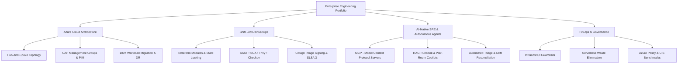
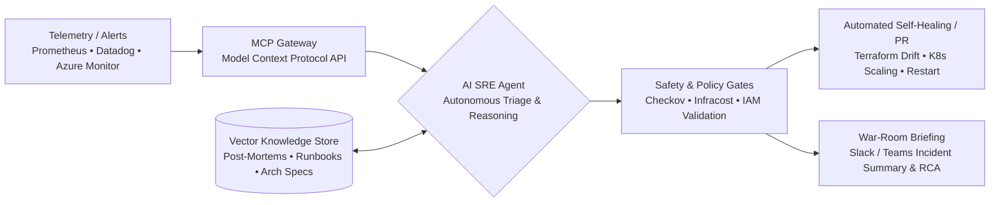

<div align="center">

  <!-- Header Banner / Animated Cyber-Cloud Wave -->
  <a href="https://github.com/aishwaryabelekar-devops">
    
  </a>

  <!-- Typing SVG Dynamic Subtitle -->
  <a href="https://github.com/aishwaryabelekar-devops">
    
  </a>

  <h3>Senior DevSecOps & Cloud Architect · AI-Native Platform Engineering · Microsoft Azure · Terraform</h3>
  <p><b>Deterministic infrastructure. Shift-left security. Autonomous AI-driven reliability.</b></p>

  <p align="center">
    <a href="https://www.linkedin.com/in/"></a>
    <a href="https://github.com/aishwaryabelekar-devops?tab=repositories"></a>
    <a href="mailto:aishwarya.belekar.work@gmail.com"></a>
    <a href="#-featured-production-grade-projects"></a>
    <a href="#-ai-native-devops--agentic-sre-mcp--rag"></a>
  </p>

</div>

---

## 👋 Executive Summary & Philosophy

I am a **Senior DevSecOps & Cloud Platform Architect** specializing in **Microsoft Azure, Zero-Trust Infrastructure as Code (Terraform), hardened CI/CD supply chains, and AI-Native SRE Systems**. 

I bridge enterprise-scale governance (Cloud Adoption Framework, Hub-and-Spoke architectures, 100+ workload migrations) with the next generation of autonomous cloud operations: building **Model Context Protocol (MCP) agents** and **Retrieval-Augmented Generation (RAG)** runbook assistants to automate incident triage, enforce compliance, and eliminate cloud waste.

- 🎯 **Target Domains:** DevSecOps Architect, Azure Cloud Architect, Platform Engineer, AI-Ops / SRE Lead
- 🛡️ **Core Discipline:** Shift-Left Security (SAST/SCA/SBOM), Terraform Landing Zones, Micro-segmentation, and FinOps
- 🤖 **AI-Native Operations:** Model Context Protocol (MCP) tool design, vector-backed SRE runbooks, autonomous drift remediation
- 🤝 [Connect with me on LinkedIn](https://www.linkedin.com/in/) · 📧 [aishwarya.belekar.work@gmail.com](mailto:aishwarya.belekar.work@gmail.com)

> **Core Operating Creed:** *A green CI/CD badge is not proof of production readiness. True engineering excellence requires verifiable evidence: automated threat models, reproducible validation gates, deterministic rollback plans, and observable systems under failure.*

---

## 🧭 Enterprise Portfolio Architecture



---

## 🧰 Technology Ecosystem & Toolchain

<div align="center">

[](https://skillicons.dev)

</div>

<br/>

| Domain | Enterprise Tools & Production Implementations |
|:---|:---|
| ☁️ **Cloud Infrastructure** | **Microsoft Azure** (Virtual Networks, Hub-and-Spoke, NSG/ASG, Azure Firewall, Application Gateway WAF, Private Endpoints, Azure Monitor, Key Vault), AWS Multi-Account, Hybrid ExpressRoute / S2S VPN |
| 🏗️ **IaC & Automation** | **Terraform**, OpenTofu, Terragrunt, Reusable Modules, Remote State Locking (Azure Blob with Lease / S3 DynamoDB), Ansible Playbooks, Cloud-Init |
| 🛡️ **DevSecOps & Supply Chain** | **Checkov**, **Trivy**, **GitLeaks**, **SonarQube**, **Falco**, **Cosign** (Keyless Sigstore), Syft/Grype (SBOM Generation), SLSA Level 3 Provenance, HashiCorp Vault, Microsoft Entra ID (PIM & JIT Access) |
| 🤖 **AI-Native & LLMOps** | **Model Context Protocol (MCP)**, **Vector RAG Pipelines**, **LangChain**, **LlamaIndex**, ChromaDB, Pinecone, Local LLMs (Ollama), Autonomous SRE Triage Agents |
| 🔄 **CI/CD & GitOps** | **GitHub Actions**, **Azure DevOps Pipelines**, GitLab CI, ArgoCD, Helm Charts, Branch Protection Policies, Multi-Stage Approval Gates |
| 📊 **Reliability & Observability** | **Prometheus**, **Grafana**, **OpenTelemetry**, Datadog, Azure Monitor Agent (AMA with DCR filtering), SLI/SLO/Error Budget tracking, Incident Runbooks |
| 💰 **FinOps & Cost Governance** | **Infracost**, Azure Cost Management, Rightsizing Analytics (P95 CPU/Memory), Automated Non-Prod Shutdown Daemons, Reserved Instance & Savings Plan Optimization |
| 🐧 **Languages & Platforms** | Python 3.11, Bash, PowerShell Core, Go, Linux (Ubuntu, RHEL, Alpine), Git Internals |

---

## 🏅 Professional Certifications & Standards

- 🎖️ **AZ-104** — Microsoft Azure Administrator
- 🎖️ **AZ-400** — Designing and Implementing Microsoft DevOps Solutions
- 🎖️ **AZ-305** — Designing Microsoft Azure Infrastructure Solutions
- 🛡️ **CIS Microsoft Azure Benchmark v2.0** — Security Architecture Standard
- 📐 **Microsoft Cloud Adoption Framework (CAF)** — Enterprise Landing Zone Foundations

---

## 🤖 AI-Native DevOps & Agentic SRE (MCP & RAG)

Modern infrastructure demands systems that operate at the speed of software. I design **autonomous agentic workflows** that integrate LLMs safely into enterprise DevOps pipelines using the **Model Context Protocol (MCP)**:



#### Autonomous Capabilities:
* **Custom MCP Servers for Cloud Diagnostics:** Built custom Model Context Protocol (MCP) servers allowing LLMs to interact with Azure Resource Graph and Kubernetes clusters in a strictly governed, read-only mode to diagnose outages without human delays.
* **Retrieval-Augmented Generation (RAG) Runbook Copilot:** Vectorized internal Architecture Decision Records (ADRs), post-mortems, and runbooks using ChromaDB to deliver exact, context-aware triage playbooks during P1/P2 outages.
* **Intelligent Infrastructure Drift Healing:** Agents that evaluate `terraform plan -detailed-exitcode`, determine if drift stems from authorized out-of-band changes, and generate reconciling Pull Requests.

---

## 🚀 Featured Production-Grade Projects

### 1. 🤖 [ai-sre-incident-agent-mcp](https://github.com/aishwaryabelekar-devops/ai-sre-incident-agent-mcp)
**Autonomous AI SRE & Incident Triage System powered by Model Context Protocol (MCP) and RAG.**
- Interfaces with Prometheus, Datadog, and Azure Monitor via custom MCP tools.
- Vectorizes operational runbooks using ChromaDB to produce instant, verifiable Root Cause Analysis (RCA) and mitigation plans.
- Enforces strict safety guardrails: generates non-destructive diagnostic queries and submits remediation Pull Requests for human sign-off.
- [Repository](https://github.com/aishwaryabelekar-devops/ai-sre-incident-agent-mcp) · [Architecture Blueprint](https://github.com/aishwaryabelekar-devops/ai-sre-incident-agent-mcp#architecture) · [MCP Tool Spec](https://github.com/aishwaryabelekar-devops/ai-sre-incident-agent-mcp/blob/main/docs/mcp-spec.md)

---

### 2. 🛡️ [azure-devsecops-landing-zone](https://github.com/aishwaryabelekar-devops/azure-devsecops-landing-zone)
**Enterprise Hub-and-Spoke Architecture adhering to the Microsoft Cloud Adoption Framework (CAF).**
- Implements central Hub VNet with Azure Firewall Premium, GatewaySubnet, and Private DNS Zones.
- Enforces Zero-Trust isolation with Network Security Groups (NSGs), Application Security Groups (ASGs), and PaaS Private Endpoints.
- Governed via Azure Policy initiatives (CIS Azure Benchmark) and automated Terraform drift-detection pipelines with remote state locking.
- [Repository](https://github.com/aishwaryabelekar-devops/azure-devsecops-landing-zone) · [Threat Model](https://github.com/aishwaryabelekar-devops/azure-devsecops-landing-zone/blob/main/docs/threat-model.md) · [CI/CD Validation Pipeline](https://github.com/aishwaryabelekar-devops/azure-devsecops-landing-zone/actions)

---

### 3. 🔒 [zero-trust-devsecops-pipeline](https://github.com/aishwaryabelekar-devops/zero-trust-devsecops-pipeline)
**Hardened Multi-Stage CI/CD Pipeline with End-to-End Supply Chain Security (SLSA Level 3).**
- Shift-Left security validation: GitLeaks (secrets), SonarQube (SAST), Checkov (IaC), and Trivy (container vulnerabilities).
- Generates Software Bill of Materials (SBOM) using Syft/Grype and cryptographically signs container images using Cosign keyless signing.
- Includes Infracost financial gates to block Pull Requests causing unapproved budget spikes.
- [Repository](https://github.com/aishwaryabelekar-devops/zero-trust-devsecops-pipeline) · [Security Policy](https://github.com/aishwaryabelekar-devops/zero-trust-devsecops-pipeline/blob/main/SECURITY.md) · [Pipeline Runs](https://github.com/aishwaryabelekar-devops/zero-trust-devsecops-pipeline/actions)

---

### 4. 📊 [sre-observability-platform](https://github.com/aishwaryabelekar-devops/sre-observability-platform)
**High-Fidelity Observability Lab with Distributed Tracing, Alerting & Runbook Automation.**
- Complete containerized telemetry stack: OpenTelemetry collectors, Prometheus metrics, Grafana dashboards, and Alertmanager.
- Production-grade Golden Signals monitoring (Latency, Traffic, Errors, Saturation) with SLI/SLO calculations and error-budget burn-rate alerts.
- Validated with synthetic traffic generators and automated failure injection runbooks.
- [Repository](https://github.com/aishwaryabelekar-devops/sre-observability-platform) · [Grafana Dashboard Specs](https://github.com/aishwaryabelekar-devops/sre-observability-platform/tree/main/dashboards) · [Runbook Library](https://github.com/aishwaryabelekar-devops/sre-observability-platform/blob/main/docs/runbooks.md)

---

### 5. 💰 [cloud-finops-sentinel](https://github.com/aishwaryabelekar-devops/cloud-finops-sentinel)
**Serverless Cloud Financial Engineering & Waste Elimination Daemon.**
- Scans multi-subscription Azure / AWS environments for unattached managed disks, orphaned snapshots, idle IP allocations, and abandoned load balancers.
- Performs 30-day P95 compute utilization analysis to generate automated rightsizing recommendations.
- Implements automated schedule tags to stop non-production sandboxes on nights and weekends, reducing dev environment spend by over 60%.
- [Repository](https://github.com/aishwaryabelekar-devops/cloud-finops-sentinel) · [ROI Calculations](https://github.com/aishwaryabelekar-devops/cloud-finops-sentinel/blob/main/docs/roi-model.md)

---

### 6. 🏢 [azure-enterprise-3-tier-architecture](https://github.com/aishwaryabelekar-devops/azure-enterprise-3-tier-architecture)
**Highly Available Multi-Zone Resilient Web, Application, and Database Ecosystem.**
- Zone-Redundant Virtual Machine Scale Sets (VMSS) behind Azure Application Gateway with OWASP 3.2 WAF protection.
- Fully isolated database tier using Azure SQL with Private Endpoints and Customer-Managed Keys (CMK) at rest.
- Geo-redundant disaster recovery design with Azure Site Recovery (ASR) to meet aggressive RTO (< 1 hour) and RPO (< 15 min) SLAs.
- [Repository](https://github.com/aishwaryabelekar-devops/azure-enterprise-3-tier-architecture) · [Architecture Runbook](https://github.com/aishwaryabelekar-devops/azure-enterprise-3-tier-architecture/blob/main/docs/runbook.md)

---

## 🏛️ Deep-Dive Enterprise Blueprints

<details>
<summary><b>🌐 1. Enterprise Hub-and-Spoke Networking Architecture (100+ Workload Scale)</b></summary>
<br />

```
                       [ On-Premises Datacenter ]
                                   |
                     (ExpressRoute / S2S VPN Gateway)
                                   |
+----------------------------------v----------------------------------+
|                   HUB VNet (Central Connectivity)                   |
|                                                                     |
|  +--------------------+   +-------------------+   +--------------+  |
|  | Azure Firewall /   |   | GatewaySubnet     |   | Private DNS  |  |
|  | NVA (Inspection)   |   | (VPN/ER Gateway)  |   | Zones        |  |
|  +---------+----------+   +-------------------+   +--------------+  |
+------------|--------------------------------------------------------+
             | (VNet Peering + UDR: 0.0.0.0/0 -> Firewall IP)
             +-----------------------+-----------------------+
             |                                               |
+------------v------------+                     +------------v------------+
|  Spoke 1: App VNet      |                     |  Spoke 2: Shared VNet   |
|  - App Tier Subnets     |                     |  - CI/CD Runners        |
|  - DB Tier Subnets      |                     |  - Bastion Host         |
|  - Private Endpoints    |                     |  - Security Tools       |
+-------------------------+                     +-------------------------+
```

* **Zero-Overlap CIDR & IPAM:** Rigorous assessment and IP allocation preventing address collision between on-premises datacenters and multi-subscription cloud networks.
* **Central Traffic Inspection:** User Defined Routes (UDRs `0.0.0.0/0`) funneling East-West and North-South traffic through Azure Firewall with deep packet TLS inspection.
* **PaaS Isolation via Private Endpoints:** Direct private links for Key Vaults, SQL instances, and Storage Accounts resolved centrally via Hub Private DNS Zones.

</details>

<details>
<summary><b>🧭 2. 100+ Enterprise Workload Migration Strategy (Microsoft CAF)</b></summary>
<br />

```
+---------------+     +--------------+     +------------+     +-----------+     +-------------+
|   Discovery   | --> |  Assessment  | --> | Readiness  | --> |  Cutover  | --> |  Hypercare  |
| Inventory,    |     | Compatibility|     | Landing    |     | Downtime  |     | 24x7 War    |
| Dependencies  |     | & TCO ROI    |     | Zone Ready |     | Window    |     | Room Support|
+---------------+     +--------------+     +------------+     +-----------+     +-------------+
```

* **Discovery & Dependency Mapping:** Automated inventory collection (Azure Migrate), application dependency visualization, bandwidth sizing, and target Landing Zone readiness validation.
* **Assessment & 6-R Strategy:** Categorizing workloads (Rehost, Replatform, Refactor, Repurchase, Retain, Retire); calculating 3-year TCO and ROI justifications.
* **Cutover Orchestration:** Database continuous replication synchronization, DNS TTL reduction, phased traffic redirection, and end-to-end smoke testing.
* **Hypercare:** 24x7 dedicated war room support (2–4 weeks), latency benchmarking, log analysis, and handover to steady-state operations.

</details>

<details>
<summary><b>🛡️ 3. Multi-Layered Defense-in-Depth Security Matrix</b></summary>
<br />

| Layer | Enterprise Controls & Hardening Measures | Standards & Tooling |
|:---|:---|:---|
| **Identity Level** | Microsoft Entra ID, Conditional Access, Multi-Factor Authentication (MFA), Privileged Identity Management (PIM) with Just-In-Time access. | Entra ID, PIM, OIDC, RBAC |
| **Networking Level** | Hub-and-Spoke, Micro-segmentation via NSGs/ASGs, Azure Firewall Premium, Private Endpoints, DDoS Protection Standard. | WAF, Azure Firewall, NSG |
| **Governance Level** | Azure Policy initiatives, CIS Azure Benchmark, MCSB compliance, automated policy drift audit/deny triggers. | Azure Policy, CIS Benchmark |
| **Compute & Containers** | Defender for Cloud/Servers, automated container vulnerability scans, CMK encryption at rest, automated OS patch baselines. | Trivy, Falco, Cosign, CMK |

</details>

<details>
<summary><b>📋 4. Delivery Governance, SOW, RACI & Vendor Management</b></summary>
<br />

```
[ RFI / RFP Assessment ] ──> [ Technical Evaluation Matrix ] ──> [ SOW & Commercials ] ──> [ Milestone Sign-Off ]
```

* **Statement of Work (SOW) Discipline:** Rigorous scoping, explicit acceptance criteria, change-request procedures, and milestone-gated payment releases.
* **Technical Evaluation Matrix:** Objective scoring of third-party vendors and tooling across architecture scalability, security compliance, past SLAs, and commercial feasibility.
* **RACI Matrix Accountability:** Enforcing operational boundaries across engineering squads: **R**esponsible, **A**ccountable, **C**onsulted, and **I**nformed.
* **Knowledge Transfer & Operational Handover:** Standard Operating Procedures (SOPs), Architecture Decision Records (ADRs), and blameless post-mortem culture.

</details>

---

## 🔐 Engineering Principles

- **Infrastructure as Code:** Keep infrastructure version-controlled, repeatable, modular, and reviewable via pull requests.
- **Shift Security Left:** Lint, scan, and test for secrets, CVEs, and compliance violations before any code reaches a staging environment.
- **Protect Credentials:** Never commit secrets or unencrypted state files; use OIDC and Managed Identities with Zero Standing Privileges.
- **Least Privilege & Blast Radius:** Partition workloads by environment subscriptions; enforce Just-In-Time PIM approvals.
- **Safer Change Management:** Generate and inspect execution plans; enforce automated drift detection to keep Git as the single source of truth.
- **Operational Readiness:** Ship architecture with automated runbooks, health dashboards, alert groups, and disaster recovery procedures.
- **Evidence Over Claims:** Quantify performance with real metrics, reproducible commands, and verified compliance benchmarks.

---

## 📈 GitHub Analytics & Engineering Velocity

<div align="center">
  <table border="0">
    <tr>
      <td>
        
      </td>
      <td>
        
      </td>
    </tr>
  </table>

  <p align="center">
    
  </p>
</div>

---

## 🤝 Connect & Collaborate

I am open to discussing **Senior Cloud Platform, DevSecOps, and AI-Native Systems Engineering roles**, architectural advisory, and high-impact open-source initiatives.

<div align="center">

  <a href="https://www.linkedin.com/in/">
    
  </a>
  &nbsp;
  <a href="mailto:aishwarya.belekar.work@gmail.com">
    
  </a>
  &nbsp;
  <a href="https://github.com/aishwaryabelekar-devops">
    
  </a>

  <br/><br/>

  <!-- Footer Banner / Animated Ocean Wave -->
  <a href="https://github.com/aishwaryabelekar-devops">
    
  </a>

  <br/>
  <sub><i>"Autonomous, secure, and resilient platforms engineered for the future of enterprise software."</i></sub>

</div>
